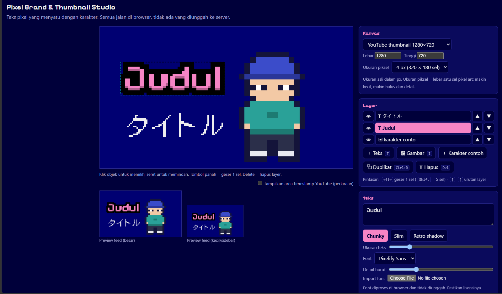

# Pixel Brand & Thumbnail Studio

Pembuat thumbnail gratis dengan gaya pixel art, yang jalan sepenuhnya di browser. Tanpa login, tanpa AI generatif: kamu yang mengatur teks, warna, dan karakter, jadi thumbnail-mu tetap konsisten dengan brand-mu.

**Coba langsung:** https://abizahyrz.github.io/pixel-brand-studio/



*A free, browser-only pixel-style thumbnail maker. No login, no generative AI, nothing leaves your device.*

## Cocok untuk

Kreator yang ingin thumbnail dengan tipografi yang menyatu dengan karakternya: VTuber, YouTuber, kreator pixel art, dan siapa pun yang tidak mau thumbnail-nya terlihat seperti hasil generate AI.

## Fitur

- **Teks pixel** dengan tiga gaya: chunky (outline + bayangan bawah), slim, dan retro shadow
- **Import font sendiri** (`.ttf`, `.otf`, `.woff`, `.woff2`)
- **Layer** teks dan gambar: pilih, geser, urutkan, sembunyikan, duplikat
- **Gambar halus atau pixel:** ilustrasi tetap tajam, atau diubah jadi pixel art dengan slider resolusi
- **Palet warna otomatis** dari karakter kamu
- **Pengecek kontras** supaya teks tetap terbaca
- **Preview ukuran feed** untuk melihat tampilan thumbnail saat kecil
- **Ukuran standar platform:** YouTube, Shorts/TikTok/Reels, Instagram, X, Facebook, atau ukuran kustom
- **Ekspor PNG** sesuai ukuran asli atau 2×
- **Pintasan keyboard:** `T` teks, `I` gambar, `Ctrl+D` duplikat, `Del` hapus, `[` `]` urutan, panah untuk menggeser

## Cara pakai

1. Pilih ukuran kanvas, misalnya YouTube 1280×720.
2. Tambahkan gambar karakter atau latar, lalu tambahkan teks.
3. Atur gaya dan warna, cek kontras dan preview feed.
4. Unduh PNG.

## Privasi

Semua diproses di browser kamu. Tidak ada login, analitik, atau pelacakan, dan gambar, teks, maupun font tidak diunggah ke mana pun. Satu-satunya permintaan keluar adalah memuat font bawaan dari Google Fonts.

## Jalankan sendiri

Proyek ini satu file HTML. Buka `index.html` di browser, atau jalankan server lokal:

```
npx serve .
```

## Dukung & kontak

Kalau tool ini berguna, kamu bisa mendukung lewat [Ko-fi](https://ko-fi.com/rookie25109).
Saran dan laporan bug: buka [Issues](https://github.com/abizahyrz/pixel-brand-studio/issues), atau hubungi [@abizahyrz di X](https://x.com/abizahyrz) atau Discord `abizahy25`.

## Lisensi

Kode: [MIT](LICENSE). Font bawaan, Pixelify Sans dan DotGothic16, berlisensi SIL Open Font License lewat Google Fonts.
